# Nikki

[](https://github.com/krissrsch/nikki/actions/workflows/test.yml)


A notch for Windows 11 that runs Claude Code. Nikki sits at the top center of the screen, starts Claude Code tasks in a project folder through your logged-in Claude Code CLI (no API key), and lets you approve its tool calls without switching windows. Around that she has the usual notch things: music, calendar, to-dos, notes, a timer, a file shelf and your Windows notifications.

The cat is drawn after my real cat Nikki.

**[Download Nikki-Setup.exe](https://github.com/krissrsch/nikki/releases)** · English and German (Settings › General)

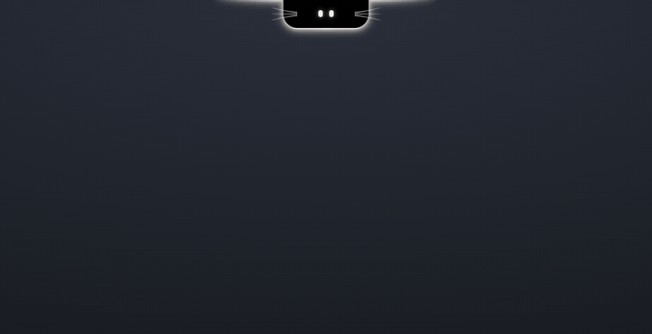

## What it does

| | |
|---|---|
| **Claude Code** | Start tasks per project, see live status and steps, answer permission requests (Allow / Always / Deny), questions and plans. Works for Claude Code sessions in your terminal too, through hooks. Plan limits shown as two rings. |
| **Closed notch** | Only Nikki's eyes and whiskers, inside a thin white edge. The edge takes a colour when something happens: yellow needs you, green works or is done, red error, the cover's colour for music, a white sweep for a new notification. A spectrum from the real audio grows under the notch. |
| **Music** | Whatever Windows plays (Spotify, browser, …): cover, controls, volume, and the line being sung (synced lyrics from [LRCLIB](https://lrclib.net), off by default). |
| **Notifications** | Notifications from other apps, collected in the island. Off by default, kept in memory only. |
| **Modules** | Calendar with reminders and repeats, to-do, notes, Pomodoro timer, file shelf, clipboard history, Discord voice channel. Each one can be switched off. |
| **Voice** | Hold a key or a mouse button (middle or side) and speak, recognised locally with whisper.cpp. "Hey Nikki, …" sends it to Claude (commands are German). |
| **Language** | English or German, or whatever Windows uses. Switches at once, no restart. |

## A closer look

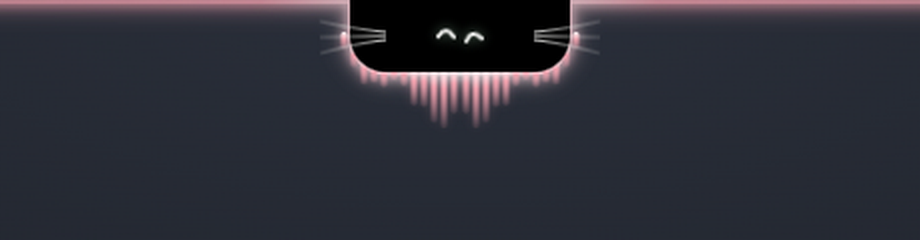

<table>
  <tr>
    <td width="50%">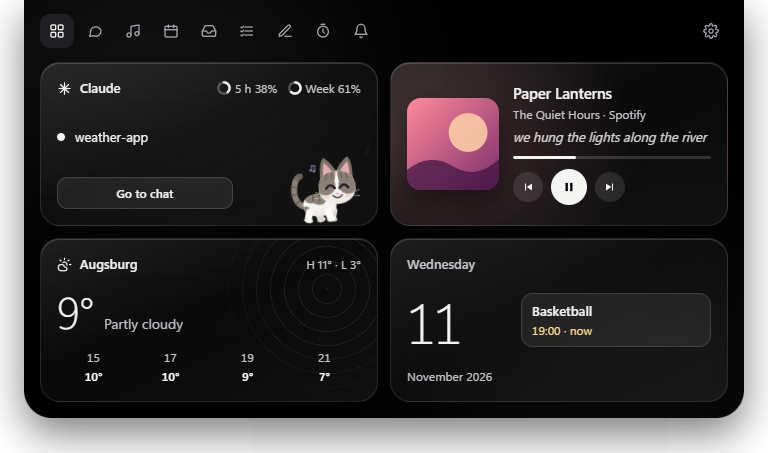<br /><sub><b>Today.</b> Claude and its plan limits, the song with the line being sung, weather, the next event.</sub></td>
    <td width="50%">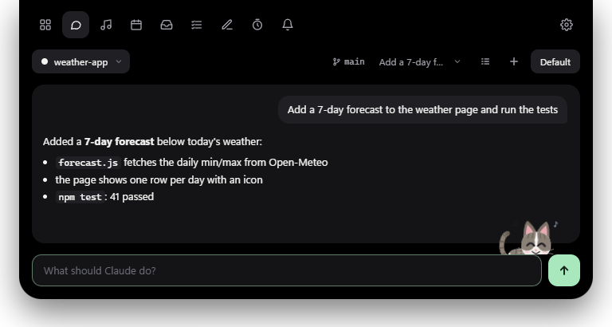<br /><sub><b>Chat.</b> A task in a project folder, with branch, model and chat history.</sub></td>
  </tr>
  <tr>
    <td>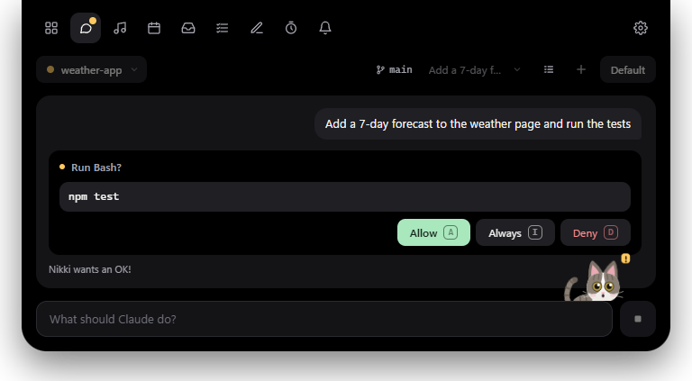<br /><sub><b>Permissions.</b> Allow, Always or Deny, by click or with A, I, D.</sub></td>
    <td>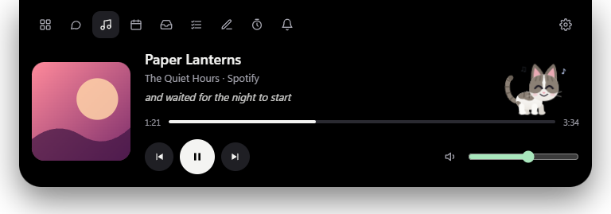<br /><sub><b>Music.</b> Any player Windows knows, with synced lyrics.</sub></td>
  </tr>
  <tr>
    <td>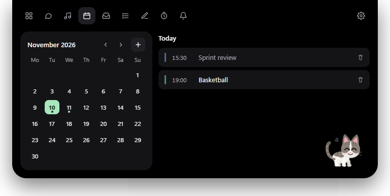<br /><sub><b>Calendar.</b> Local, with repeats and a reminder 15 minutes before.</sub></td>
    <td>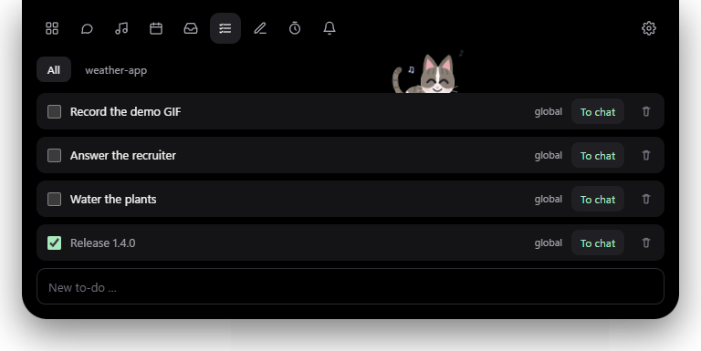<br /><sub><b>To-do.</b> Global or per project, and “To chat” hands one to Claude.</sub></td>
  </tr>
  <tr>
    <td>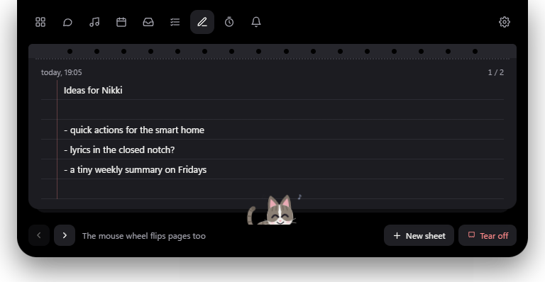<br /><sub><b>Notes.</b> A tear-off pad, flipped with the mouse wheel. A torn sheet can come back for a few seconds.</sub></td>
    <td>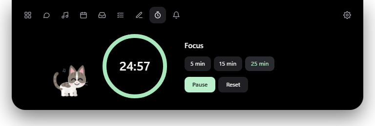<br /><sub><b>Timer.</b> Pomodoro with 5, 15, 25 minutes or your own length, and today's focus rounds.</sub></td>
  </tr>
  <tr>
    <td>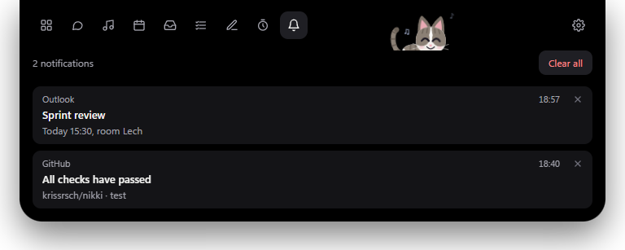<br /><sub><b>Notifications.</b> What other apps tell you, in one place.</sub></td>
    <td>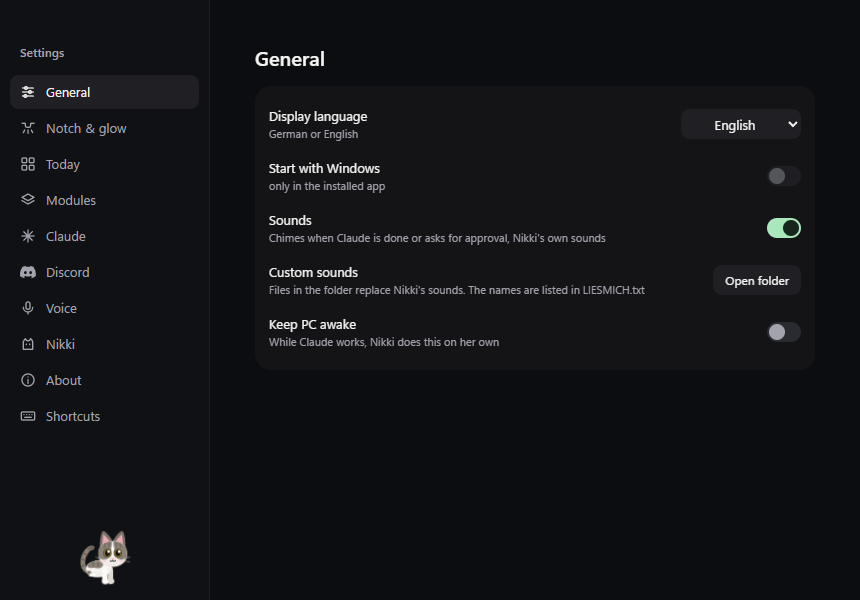<br /><sub><b>Settings.</b> Its own window: language, sounds, glow, modules, hotkeys.</sub></td>
  </tr>
</table>

## How it works

```
 ┌───────────────────────── Electron ─────────────────────────┐
 │  renderer/ (island, modules)  ⇄  preload.cjs  ⇄  main.js   │
 └──────────────────────────────────────┬──────────┬──────────┘
                                        │          │
             Claude Agent SDK ──────────┘          └──── helper/NikkiHelper.exe (C#)
             └ logged-in claude.exe                     JSON lines over stdin/stdout:
                                                        media (SMTC), volume, audio spectrum
 Claude Code in a terminal                              (WASAPI loopback), notifications,
   └ hook.cjs ── local HTTP ──► main.js                 push-to-talk, window focus
```

- **main.js** owns all state, files and network. The renderer only gets what it needs through `preload.cjs`; module ids are checked before they turn into file names.
- **backends/claude.js** runs one task at a time through `@anthropic-ai/claude-agent-sdk` and turns its stream into a status and a step list (`lib/status.js`).
- **helper/NikkiHelper.cs** is a small C# program built with the compiler that ships with Windows (`helper/build.cmd`), for the Windows APIs Node cannot reach.
- **hook.cjs** is what Claude Code calls for terminal sessions. It posts the event to Nikki and, for permissions, waits for the answer from the island.
- **renderer/i18n.js** translates the interface. German is the source and `i18n/en.json` maps it to English; a MutationObserver swaps text and tooltips as they appear, so no call site has to know about languages.
- Pure logic lives in `lib/` and the top of each renderer module, with unit tests next to it. `e2e/` drives the real app with Playwright in a temp profile, offline and muted.

## Build

Needs Windows 11, Node.js 24 and an installed, logged-in [Claude Code](https://claude.ai/code).

```bash
npm install
npm start
npm test                 # unit tests, also run in CI
npm run e2e              # Playwright against the real app, isolated (see e2e/README.md)
node e2e/screenshots.js  # the screenshots above, with demo data (add "de" for German)
node e2e/demo.js         # the demo GIF (needs ffmpeg)
npm run dist             # builds Nikki-Setup.exe
```

Default hotkey: `Ctrl+Alt+Space` (fallback `Ctrl+Alt+K`), changeable in the settings.

## What's next

Nikki is going to become an iOS app as well. The iPhone already has its notch, the Dynamic Island, so the cat would live there as a Live Activity. Claude Code cannot run on the phone itself, so the app would be a companion to Nikki on the PC: it shows how a running task is doing and lets you answer permissions and questions on the go. Not started yet.

---

## Deutsch

Notch-App für Windows mit Claude-Code-Begleiter: die kleine Katze oben am Bildschirmrand. Sie startet und begleitet Claude-Code-Aufgaben in deinem Projektordner über deine lokal eingeloggte **Claude Code**-CLI, **ohne API-Key**, und bringt dazu Notch-Module wie Kalender, To-do, Notizen und Timer mit.

Zugeklappt zeigt die Insel nur Nikkis Augen und Schnurrhaare, rundherum eine schmale weiße Kante. Passiert etwas, färbt sie sich: gelb braucht dich, grün arbeitet oder ist fertig, rot ist ein Fehler, bei Musik leuchtet sie in der Farbe des Covers, und eine neue Mitteilung streift einmal weiß darüber. Aufgeklappt gibt es Home („Heute“: Claude, Musik, Wetter, Kalender), den Chat und die Module.

- Claude Code starten, mit Live-Status, Schritten und Antworten in der Insel
- Berechtigungen, Fragen und Pläne beantworten (Erlauben / Immer / Ablehnen), auch für Claude-Code-Sessions im Terminal
- Claude-Kachel mit 5-Stunden- und Wochenlimit als Ringe
- Musik mit Cover, Steuerung, Lautstärke und der gerade gesungenen Zeile (Songtexte von lrclib.net, standardmäßig aus)
- Mitteilungen anderer Apps in der Insel (standardmäßig aus, nur im Speicher)
- Module: Kalender mit Wiederholungen, To-do, Notizen, Timer mit eigener Dauer, Ablage, Zwischenablage, Discord, einzeln schaltbar
- Beim ersten Start eine kurze Einrichtung: Claude da? Projektordner? Wie öffne ich Nikki?
- Spracheingabe, lokal erkannt, per Taste oder Maustaste (Mitte oder Seite). Befehle beginnen mit „Hey Nikki“
- Bei Spiel oder Video im Vollbild geht Nikki aus dem Weg
- Oberfläche auf Deutsch oder Englisch (Einstellungen › Allgemein), ohne Neustart

Voraussetzung: Windows 11 und ein installiertes, eingeloggtes Claude Code. Installer: **Nikki-Setup.exe** unter [Releases](https://github.com/krissrsch/nikki/releases).

**Geplant:** Nikki wird später zur iOS-App ausgebaut. Das iPhone hat seine Notch schon, die Dynamic Island, dort lebt die Katze dann als Live Activity. Claude Code selbst läuft nicht auf dem Handy, deshalb begleitet die App Nikki auf dem PC: Sie zeigt, wie eine laufende Aufgabe steht, und du kannst Berechtigungen und Fragen unterwegs beantworten. Noch nicht begonnen.

## License

[MIT](LICENSE)
